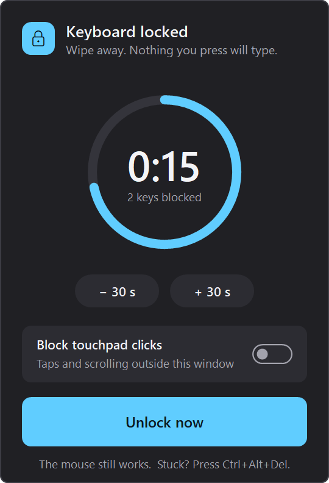
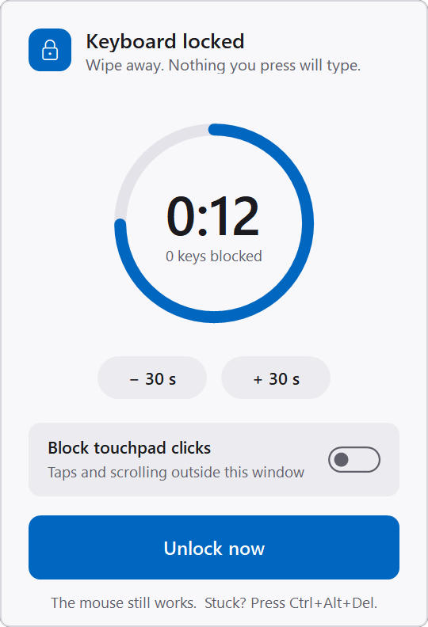

# Keyboard Lock

Lock your laptop keyboard for a couple of minutes so you can wipe it clean without typing anything. One double-clickable file, nothing to install.

<p align="center">
  
  &nbsp;&nbsp;
  
</p>

## What it does

- Blocks every key the moment it opens, and counts the keys it blocked.
- Unlocks by itself when the countdown ends (2 minutes by default), with a short sound.
- **+30 s / -30 s** buttons change the time while it is running.
- **Block touchpad clicks** (optional): taps and scrolling outside the window are ignored too, so wiping the touchpad doesn't click anything. The pointer still moves, and the window itself still works.
- Follows the Windows light or dark theme and stays sharp on scaled screens (125%, 150%, ...).
- Only one copy runs at a time. Opening it again just brings the window back to the front.

## How to use

1. Download [`KeyboardLock.bat`](KeyboardLock.bat) (Code > Download ZIP, or open the file and click the download button).
2. Double-click it. The window appears and the keyboard is locked.
3. Clean the keyboard.
4. Click **Unlock now**, or just wait for the timer.

Want a different time just once? Run it from a terminal with the number of seconds, for example `KeyboardLock.bat 60`.

## How to unlock

Any one of these works:

| Way | What to do |
| --- | --- |
| Button | Click **Unlock now**. With touchpad blocking on, press and hold it for 1 second (so a wipe can't hit it by accident). |
| Timer | Wait. It unlocks on its own when the countdown reaches 0:00. |
| Close the window | Close it from the taskbar (right-click > Close window). |
| Emergency | Press **Ctrl+Alt+Del**. Windows never lets programs block this, and Keyboard Lock unlocks as soon as that screen appears. Press Esc to go back. |

## Settings

Open `KeyboardLock.bat` in Notepad and change the lines at the top:

```powershell
$lockSeconds   = 120      # auto-unlock after this many seconds (10 to 3600)
$blockTouchpad = $false   # start with touchpad / mouse clicks blocked too
$playSound     = $true    # play a short sound when the timer unlocks
$theme         = 'auto'   # 'auto' (follow Windows), 'dark' or 'light'
```

## Safety notes

- The lock only lives as long as the window. Closing it, the timer, a crash, signing out or ending the process in Task Manager all give the keyboard back, because Windows removes the keyboard hook when the program exits.
- The mouse always keeps working, so the unlock button is always reachable.
- It doesn't log or save anything you press. It only counts them.
- Some antivirus or anti-cheat programs don't allow keyboard hooks. If so, you get a message saying so and nothing is locked.
- A few touchpad gestures (like three-finger swipes) are handled by Windows itself and may still work while touchpad blocking is on.

## How it works

The file is both a batch file and a PowerShell script. The batch part at the top starts a hidden PowerShell, which compiles a small C# class and installs a low-level keyboard hook (`WH_KEYBOARD_LL`) that swallows every key, plus an optional mouse hook for the touchpad option. The window is drawn with Windows Forms.

Made for Windows 11 (should also work on Windows 10). Uses the built-in Windows PowerShell 5.1.

## License

[MIT](LICENSE)
